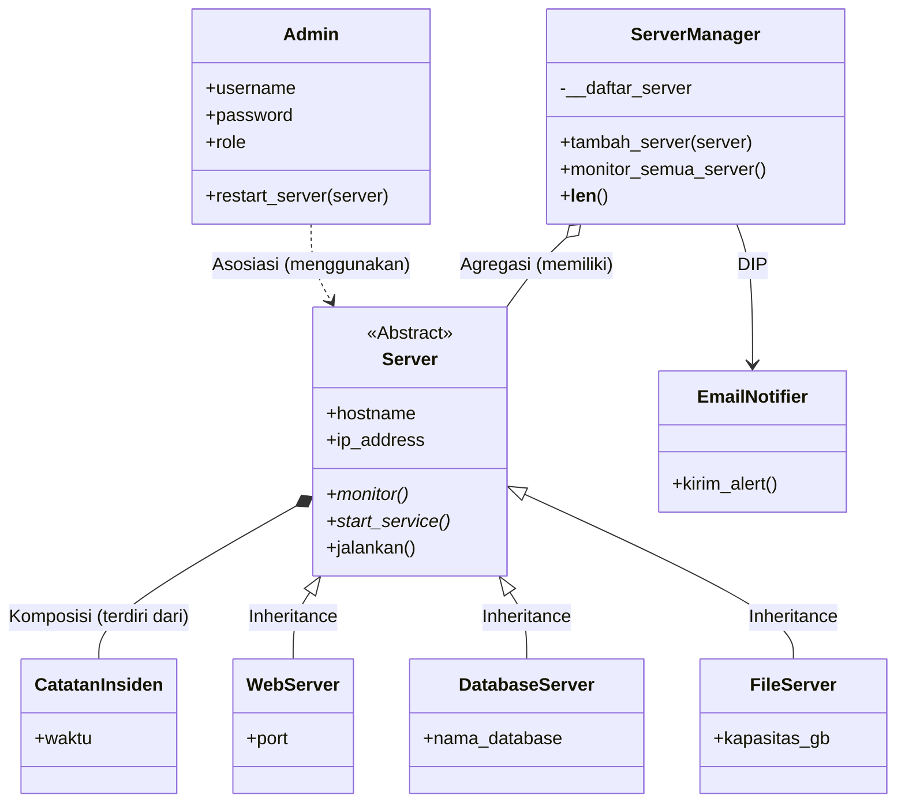

# SIMANSER - Sistem Informasi Manajemen Administrasi dan Monitoring Server

## 1. Deskripsi Singkat
SIMANSER adalah program simulasi peran **Systems Administrator** untuk mengelola sekumpulan server (Web, Database, File) menggunakan pendekatan OOP (Python). Program ini mengimplementasikan relasi UML, Abstraksi, Polimorfisme, dan prinsip SOLID.

## 2. Class Diagram & Relasi UML
Berikut adalah relasi antar kelas di dalam program.



### Penjelasan Relasi:

    Asosiasi (Admin ..> Server): Terjadi karena Admin menggunakan objek Server sebagai parameter pada method restart_server(server). Admin tidak menyimpan Server secara permanen sebagai atribut, sehingga sifatnya hanya menggunakan sementara.

    Agregasi (ServerManager o-- Server): Terjadi karena ServerManager memiliki atribut list __daftar_server. Objek Server dibuat di luar dan dimasukkan ke dalam manager. Jika ServerManager dihapus, objek Server tetap bisa berdiri sendiri.

    Komposisi (Server *-- CatatanInsiden): Terjadi karena Server membuat objek CatatanInsiden langsung di dalam dirinya melalui method catat_insiden(). Jika Server dihancurkan, maka seluruh riwayat CatatanInsiden miliknya juga ikut musnah.

## 3. Abstraksi (Abstract Base Class)

    Abstract Class: Server(Monitorable, Manageable).

    Abstract Method: Memiliki 2 method abstrak, yaitu monitor() dan start_service().

    Method Konkret: Memiliki method jalankan() yang memanggil start(), start_service(), dan monitor() secara berurutan.

    Subclass: WebServer, DatabaseServer, dan FileServer mengimplementasikan seluruh method abstrak tersebut.

    Bukti Abstraksi: Program mendemonstrasikan error TypeError saat mencoba menginstansiasi Server secara langsung (lihat output bagian [1] Bukti Abstraksi).

## 4. Polimorfisme

Program menerapkan 3 jenis polimorfisme:

    A. Polimorfisme via Pewarisan: Method monitor() di-override oleh WebServer, DatabaseServer, dan FileServer. Ketiganya dipanggil dalam satu loop melalui method monitor_semua_server() pada ServerManager.

    B. Duck Typing: Kelas EmailNotifier dan SMSNotifier tidak memiliki hubungan pewarisan, tetapi keduanya memiliki method kirim_alert(). Keduanya diproses oleh satu fungsi yang sama, yaitu proses_notifikasi(notifier, pesan).

    C. Operator Overloading: Menerapkan magic method __len__ pada class ServerManager (mengembalikan jumlah server) dan __str__ pada class Server.

## 5. Penerapan Prinsip SOLID (Nilai Plus)

Program ini menerapkan 2 prinsip SOLID:

    Dependency Inversion Principle (DIP): Class ServerManager tidak menginstansiasi notifier secara langsung di dalam dirinya. ServerManager bergantung pada abstraksi Notifier, dan objek konkretnya (seperti EmailNotifier) disuntikkan (dependency injection) melalui parameter konstruktor __init__(self, admin, notifier: Notifier).

    Single Responsibility Principle (SRP): Tanggung jawab dipisahkan dengan rapi. Admin mengurus autentikasi, Server mengurus state dan insiden, ServerManager mengurus CRUD dan orkestrasi, dan Notifier khusus mengurus pengiriman pesan peringatan.

## 6. Panduan Pengujian

Jalankan perintah berikut di terminal:
```bash
python simanser.py
```

Skenario Output yang Akan Muncul:

    Bukti Abstraksi: Muncul pesan error menandakan Server tidak bisa diinstansiasi.


    Polimorfisme Pewarisan: Mencetak status 3 server berbeda dengan format spesifik masing-masing.


    Duck Typing: Memanggil fungsi notifikasi yang sama untuk Email dan SMS.


    Operator Overloading: Mencetak jumlah server menggunakan fungsi bawaan len().


    Asosiasi: Admin melakukan restart pada web server.


    Komposisi: Menampilkan riwayat insiden yang otomatis tercatat di dalam objek Database Server saat RAM-nya tinggi.


## 7. Repositori Github
```text
https://github.com/nugrahreswara/simanser
```


